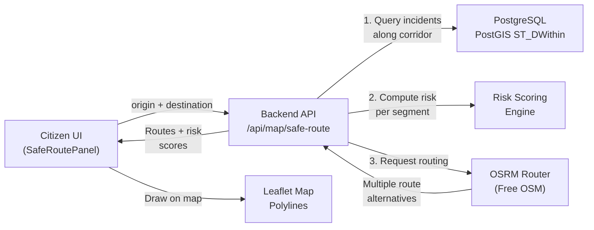

# 🛡️ Safe Route Navigator — Implementation Plan

## Overview

A citizen enters an **origin** and **destination** on the map, and TRACE draws the **safest walking/commuting route** — not just the shortest path — by penalizing road segments near verified crime incidents weighted by severity and recency. The user sees a side-by-side comparison: **Fastest Route vs Safest Route** with risk scores.

---

## Architecture



---

## Files to Create/Modify

### 🆕 New Files

| File | Purpose |
|:---|:---|
| [`frontend/src/components/SafeRoutePanel.tsx`](file:///d:/COLLEGE/FINAL%20YEAR/TRACE/frontend/src/components/SafeRoutePanel.tsx) | New component: search inputs, route comparison UI, risk breakdown |
| [`backend/src/controllers/saferoute.controller.ts`](file:///d:/COLLEGE/FINAL%20YEAR/TRACE/backend/src/controllers/saferoute.controller.ts) | New controller: orchestrates OSRM call + PostGIS risk scoring |
| [`backend/src/routes/saferoute.routes.ts`](file:///d:/COLLEGE/FINAL%20YEAR/TRACE/backend/src/routes/saferoute.routes.ts) | New route: `GET /api/map/safe-route` |

### ✏️ Modified Files

| File | What Changes |
|:---|:---|
| [`frontend/src/components/SafetyMap.tsx`](file:///d:/COLLEGE/FINAL%20YEAR/TRACE/frontend/src/components/SafetyMap.tsx) | Add new props for route mode: draw route polylines, origin/destination markers, expose map instance |
| [`frontend/src/App.tsx`](file:///d:/COLLEGE/FINAL%20YEAR/TRACE/frontend/src/App.tsx) | Add "Safe Route" toggle button in map view header, state for route mode, render `SafeRoutePanel` |
| [`frontend/src/services/api.ts`](file:///d:/COLLEGE/FINAL%20YEAR/TRACE/frontend/src/services/api.ts) | Add `getSafeRoute(origin, destination)` API method |
| [`backend/src/index.ts`](file:///d:/COLLEGE/FINAL%20YEAR/TRACE/backend/src/index.ts) | Register new `/api/map/safe-route` route |
| [`frontend/src/index.css`](file:///d:/COLLEGE/FINAL%20YEAR/TRACE/frontend/src/index.css) | Route panel CSS (glassmorphism panel, route comparison cards) |
| [`frontend/package.json`](file:///d:/COLLEGE/FINAL%20YEAR/TRACE/frontend/package.json) | No new npm packages needed (pure Leaflet polylines, no routing-machine needed) |

---

## Detailed Design

### Phase 1: Backend — Safe Route API

#### New Endpoint: `GET /api/map/safe-route`

**Query parameters:**
```
originLat, originLng    — Starting point coordinates
destLat, destLng        — Destination coordinates
mode                    — "walking" | "driving" (default: "walking")
```

**Algorithm:**

1. **Get route alternatives from OSRM** (free public API, no key needed):
   ```
   GET https://router.project-osrm.org/route/v1/walking/
     {originLng},{originLat};{destLng},{destLat}
     ?alternatives=3&overview=full&geometries=geojson&steps=true
   ```
   This returns up to 3 alternative routes with full coordinate geometry.

2. **For each route, compute a "risk score"** by querying PostGIS:
   - Decode each route's GeoJSON `LineString` geometry
   - Sample points along the route every ~200m
   - For each sample point, count verified incidents within a **300m buffer** using `ST_DWithin`
   - Weight by severity: `CRITICAL=10, HIGH=5, MEDIUM=2, LOW=1`
   - Weight by recency: incidents in last 30 days × 2.0, last 90 days × 1.5, older × 1.0
   - **Route Risk Score** = sum of all weighted incident counts along the route
   - **Safety Score** = `max(0, 100 - riskScore * scalingFactor)` → normalized 0–100

3. **Return response:**
   ```json
   {
     "routes": [
       {
         "name": "Safest Route",
         "geometry": { "type": "LineString", "coordinates": [...] },
         "distance_km": 2.3,
         "duration_min": 28,
         "safety_score": 87,
         "risk_score": 12,
         "incident_count_along_route": 5,
         "risk_breakdown": {
           "CRITICAL": 0, "HIGH": 1, "MEDIUM": 2, "LOW": 2
         }
       },
       {
         "name": "Fastest Route",
         "geometry": { ... },
         "distance_km": 1.8,
         "duration_min": 22,
         "safety_score": 61,
         "risk_score": 38,
         "incident_count_along_route": 14,
         "risk_breakdown": { ... }
       }
     ],
     "origin": { "lat": 18.52, "lng": 73.85 },
     "destination": { "lat": 18.53, "lng": 73.87 }
   }
   ```

4. **Sort routes by safety_score DESC** — safest first.

#### PostGIS Risk Query (per sample point):
```sql
SELECT 
  COUNT(*) AS total,
  COUNT(CASE WHEN severity = 'CRITICAL' THEN 1 END) AS critical,
  COUNT(CASE WHEN severity = 'HIGH' THEN 1 END) AS high,
  COUNT(CASE WHEN severity = 'MEDIUM' THEN 1 END) AS medium,
  COUNT(CASE WHEN severity = 'LOW' THEN 1 END) AS low,
  COUNT(CASE WHEN occurred_at > NOW() - INTERVAL '30 days' THEN 1 END) AS recent_30d
FROM incidents
WHERE status = 'VERIFIED' AND is_public = true
  AND ST_DWithin(
    location::geography,
    ST_SetSRID(ST_MakePoint($1, $2), 4326)::geography,
    300  -- 300 meters buffer
  )
```

> [!NOTE]
> We already have PostGIS `ST_DWithin` used in [`getNearbyIncidents`](file:///d:/COLLEGE/FINAL%20YEAR/TRACE/backend/src/controllers/map.controller.ts#L185-L249) — the safe route just applies this logic to **multiple sample points along a route** instead of a single point.

---

### Phase 2: Frontend — SafeRoutePanel Component

#### UI Layout (inside the map view sidebar)

```
┌─────────────────────────────────┐
│  🛡️ SAFE ROUTE NAVIGATOR       │
│  ─────────────────────────────  │
│  📍 Origin                     │
│  ┌─────────────────────────┐   │
│  │ Click map or type area  │   │
│  └─────────────────────────┘   │
│                                 │
│  🏁 Destination                │
│  ┌─────────────────────────┐   │
│  │ Click map or type area  │   │
│  └─────────────────────────┘   │
│                                 │
│  [🚶 Walking]  [🚗 Driving]   │
│                                 │
│  [ 🔍 Find Safest Route ]      │
│                                 │
│  ═══════════════════════════    │
│                                 │
│  ┌── SAFEST ──────────────┐    │
│  │ 🟢 Safety: 87/100      │    │
│  │ 📏 2.3 km · 28 min     │    │
│  │ ⚠️ 5 incidents nearby  │    │
│  │ ████████████░░░░        │    │
│  └─────────────────────────┘   │
│                                 │
│  ┌── FASTEST ─────────────┐    │
│  │ 🟡 Safety: 61/100      │    │
│  │ 📏 1.8 km · 22 min     │    │
│  │ ⚠️ 14 incidents nearby │    │
│  │ ██████░░░░░░░░░░        │    │
│  └─────────────────────────┘   │
│                                 │
│  Risk Breakdown:               │
│  CRITICAL ▰▰ 0                │
│  HIGH     ▰▰ 1                │
│  MEDIUM   ▰▰▰ 2              │
│  LOW      ▰▰ 2                │
│                                 │
│  [ ✕ Clear Route ]             │
└─────────────────────────────────┘
```

#### Interaction Flow:
1. User clicks **"Safe Route"** button in the map header → enters route mode
2. The right sidebar switches from **Incident Stream** to **SafeRoutePanel**
3. User can either **click the map** to set origin/destination (just like report pin mode) or **type a location name**
4. Clicking "Find Safest Route" calls `api.getSafeRoute()`
5. The map draws **two polylines**: green (safest) and orange (fastest)
6. The panel shows the comparison cards
7. Clicking a route card highlights it on the map
8. "Clear Route" exits route mode and returns to normal incident view

#### Map Visual Changes (SafetyMap.tsx):
- **New props**: `routeMode`, `routes`, `onSetOrigin`, `onSetDestination`, `originLocation`, `destinationLocation`
- **Origin marker**: Green circle pin with "A" label
- **Destination marker**: Red circle pin with "B" label
- **Safest route polyline**: Solid green line, weight 6, opacity 0.85
- **Fastest route polyline**: Dashed orange line, weight 4, opacity 0.6
- **Risk zones along route**: Translucent red circles at high-incident segments
- In route mode, the map click handler alternates between setting origin and destination

---

### Phase 3: App.tsx Integration

#### State additions:
```tsx
const [routeMode, setRouteMode] = useState(false);
const [originLocation, setOriginLocation] = useState<{lat: number; lng: number} | null>(null);
const [destinationLocation, setDestinationLocation] = useState<{lat: number; lng: number} | null>(null);
const [routeResults, setRouteResults] = useState<RouteResult[] | null>(null);
const [routeLoading, setRouteLoading] = useState(false);
```

#### UI changes to map view header:
- Add a **"🛡️ Safe Route"** toggle button next to the existing "Drop Pin on Map" and "Report Incident" buttons
- When active, the right sidebar (currently showing incident stream) switches to `<SafeRoutePanel />`
- The `<SafetyMap>` receives new route-mode props

---

### Phase 4: API Service Layer

#### New method in [`api.ts`](file:///d:/COLLEGE/FINAL%20YEAR/TRACE/frontend/src/services/api.ts):
```typescript
async getSafeRoute(
  originLat: number, originLng: number,
  destLat: number, destLng: number,
  mode: 'walking' | 'driving' = 'walking'
) {
  const params = new URLSearchParams({
    originLat: String(originLat),
    originLng: String(originLng),
    destLat: String(destLat),
    destLng: String(destLng),
    mode,
  });
  const res = await fetch(`${API_BASE}/map/safe-route?${params}`, {
    headers: getAuthHeader(),
  });
  if (!res.ok) throw new Error('Failed to compute safe route');
  return res.json();
}
```

---

## Execution Checklist

| # | Task | Layer | File(s) |
|:---:|:---|:---:|:---|
| 1 | Create `saferoute.controller.ts` — OSRM fetch + PostGIS risk scoring | Backend | `controllers/saferoute.controller.ts` |
| 2 | Create `saferoute.routes.ts` — wire up `GET /api/map/safe-route` | Backend | `routes/saferoute.routes.ts` |
| 3 | Register route in `index.ts` | Backend | `index.ts` |
| 4 | Add `getSafeRoute()` to `api.ts` | Frontend | `services/api.ts` |
| 5 | Create `SafeRoutePanel.tsx` — UI panel with inputs + route cards | Frontend | `components/SafeRoutePanel.tsx` |
| 6 | Add route-mode props to `SafetyMap.tsx` — polylines, markers | Frontend | `components/SafetyMap.tsx` |
| 7 | Integrate into `App.tsx` — state, toggle button, sidebar switch | Frontend | `App.tsx` |
| 8 | Add CSS for route panel (glassmorphism, safety bars, animations) | Frontend | `index.css` |
| 9 | Test end-to-end: set origin/dest → see routes on map with scores | Full stack | — |

---

## Key Technical Decisions

| Decision | Choice | Rationale |
|:---|:---|:---|
| **Routing engine** | OSRM public API (free, no API key) | Already OSM-based like our Leaflet tiles. No cost. `alternatives=3` gives multiple paths to compare. |
| **Risk buffer radius** | 300 meters | Wide enough to catch nearby-street incidents, narrow enough not to penalize unrelated areas. Configurable. |
| **Sample spacing** | Every ~200m along route | Balances accuracy vs. query count. A 3km route = ~15 sample points × 3 routes = ~45 PostGIS queries (fast with GiST index). |
| **No new npm packages** | Pure Leaflet `L.polyline` | Avoids `leaflet-routing-machine` dependency (maintenance mode). We get raw GeoJSON from OSRM and draw it ourselves. Full control over styling. |
| **Recency weighting** | Last 30d × 2.0, 90d × 1.5, older × 1.0 | Recent crimes matter more for route safety than year-old incidents. |

> [!IMPORTANT]
> The OSRM public demo server (`router.project-osrm.org`) has rate limits. For the B.Tech demo this is fine — it handles occasional requests well. If ever deployed at scale, you'd self-host an OSRM instance.

---

## What This Does NOT Change

- ❌ No database schema changes needed
- ❌ No new npm packages to install
- ❌ No changes to the moderation workflow
- ❌ No changes to auth/RBAC
- ❌ No changes to the AI service

Everything builds on **existing PostGIS spatial queries** and **existing Leaflet map infrastructure**.
